<div align="center">

# owli-parser

**企业知识库的文件解析 · 可追溯分块 · 可解释问答工作台**

从「上传一个文件」到「用一句话问出答案并点回原文那一行」的完整工程实现。

Python 3.12 · FastAPI · SQLAlchemy 2 · PostgreSQL / SQLite · Celery + Valkey
React 19 · TypeScript strict · Vite · Tailwind · TanStack Query · React Flow · pdf.js

契约先行 · 至少一次执行 · 先发布后可见 · 可解释不伪造

</div>

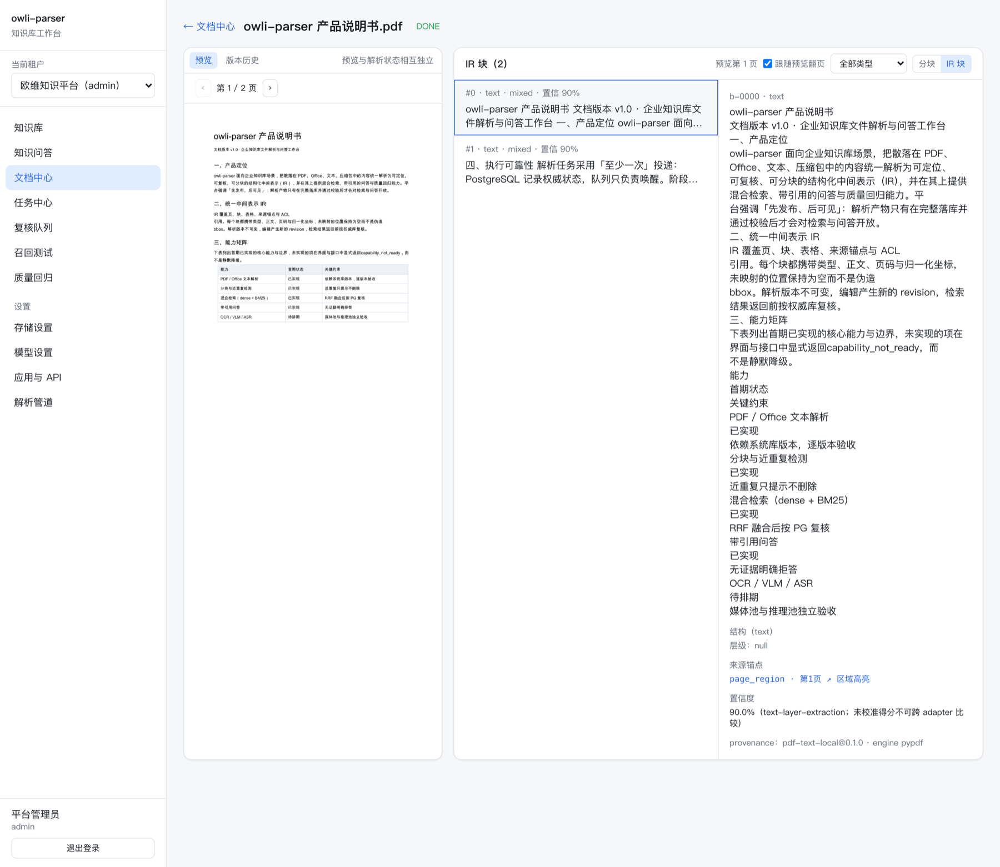

---

## 目录

- [1. 一句话说清它是做什么的](#1-一句话说清它是做什么的)
- [2. 界面速览（真实运行截图）](#2-界面速览真实运行截图)
- [3. 小白术语表](#3-小白术语表)
- [4. 能力地图与边界](#4-能力地图与边界)
- [5. 架构总览](#5-架构总览)
- [6. 十个关键设计细节](#6-十个关键设计细节)
- [7. 仓库目录结构](#7-仓库目录结构)
- [8. 快速开始（本地 10 分钟）](#8-快速开始本地-10-分钟)
- [9. 配置与密钥](#9-配置与密钥)
- [10. API 与契约工作流](#10-api-与契约工作流)
- [11. 测试与质量门禁](#11-测试与质量门禁)
- [12. 部署与运维](#12-部署与运维)
- [13. 已知边界与路线图](#13-已知边界与路线图)
- [14. 本次交付附带的问题修复](#14-本次交付附带的问题修复)
- [15. 文档导航与合规提示](#15-文档导航与合规提示)

---

## 1. 一句话说清它是做什么的

企业里的知识散落在 PDF 合同、Word 方案、Excel 指标表、Markdown 手册、网页导出文件里。
这些文件「能看不能用」：搜不到、切不准、答不对、指不回原文。

owli-parser 把它们变成**可定位、可复核、可分块、可检索、可引用**的结构化数据：

```text
                 ┌──────────────┐      ┌──────────────┐      ┌──────────────┐
 上传 / URL 导入 → │  解析 + 规范化 │  →   │  IR 2.0 统一   │  →   │  分块 + 索引   │
                 │  (插件化适配器) │      │  中间表示      │      │  发布协议      │
                 └──────────────┘      └──────────────┘      └──────────────┘
                                                                     ↓
                     带引用的问答  ←  混合检索（dense + BM25 + RRF）  ←  已发布版本
```

四个产品承诺，贯穿全部代码：

| 承诺 | 具体含义 | 代码里怎么落实 |
|---|---|---|
| **先发布，后可见** | 半成品永远不进检索/问答 | `desired_version` / `visible_version` 分离 + CAS 发布 + 索引 manifest 逐通道确认 |
| **可解释，不伪造** | 说不清来源就明说「定位不到」 | 未映射坐标留空而非造 bbox；单侧缺失的指标显示 `—` 而不是 0 |
| **失败要响，不静默降级** | 缺模型、缺引擎、缺证据都显式失败 | `capability_not_ready` / 低相关警告 / 无证据拒答 |
| **状态以数据库为权威** | 队列只负责唤醒，不承载事实 | PostgreSQL 存状态 + outbox 派发 + 租约与 fencing token |

---

## 2. 界面速览（真实运行截图）

> 以下截图来自本仓库代码在本地真实运行的界面（示例租户「欧维知识平台」、6 篇文档、1 次解析质量对比运行）。
> 全部原图见 [`docs/screenshots/`](docs/screenshots/)，共 16 张。

| 页面 | 路由 | 你可以看到什么 |
|---|---|---|
| 文档工作台 | `/documents/{id}` | 原文预览 + 分块 + IR 块 + 来源锚点 + 置信度 + provenance |
| 任务中心 / 任务详情 | `/tasks`、`/tasks/{id}` | 列表页状态与覆盖率；单任务阶段流转、事件时间线、页级步骤 |
| 召回测试台 | `/retrieval` | 通道 rank / 原始分 / RRF 贡献 / 参数回显 / A-B 对比 |
| 质量回归 | `/quality` | 黄金集运行历史、指标 chips、趋势图、明细与 diff |
| 解析管道 | `/settings/pipelines` | YAML / 表单 / 画布三视图，版本化保存 |
| 应用与 API | `/settings/applications` | scope 注册表、数据集授权矩阵、Token 生命周期 |

### 2.1 知识库与文档中心

学习一个知识库产品，第一步永远是「东西放在哪里」。数据集是权限与存储的最小单位，
文档是版本与发布的最小单位。

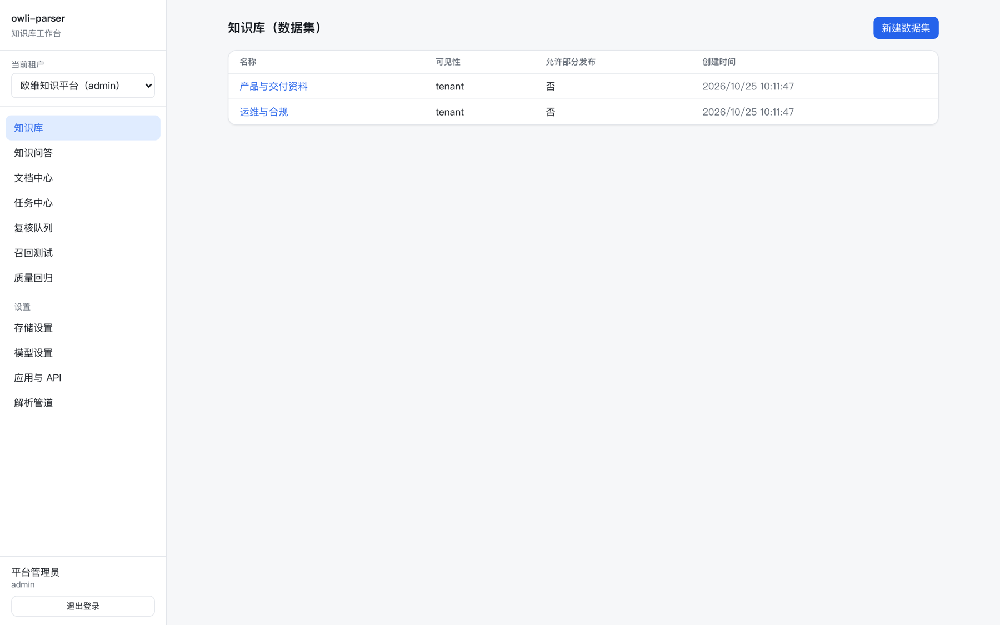

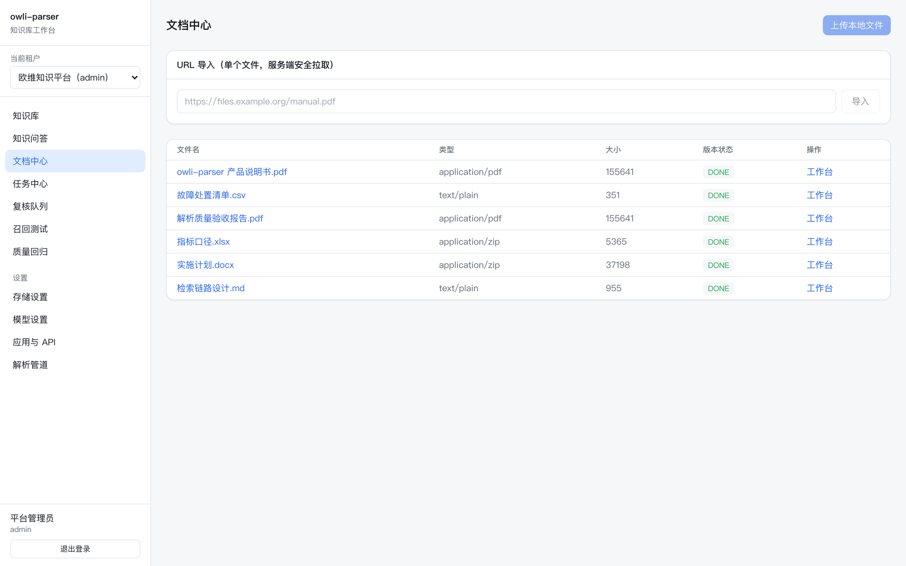

### 2.2 文档工作台：一次点击完成「答案 → 原文」的回溯

左边是原文渲染（PDF 由 pdf.js 懒加载渲染），中间是**分块视图**和**IR 块视图**，
右边是选中项的正文、**来源锚点**、置信度与 provenance。点击「区域高亮」会把预览翻到对应页并画出 bbox。

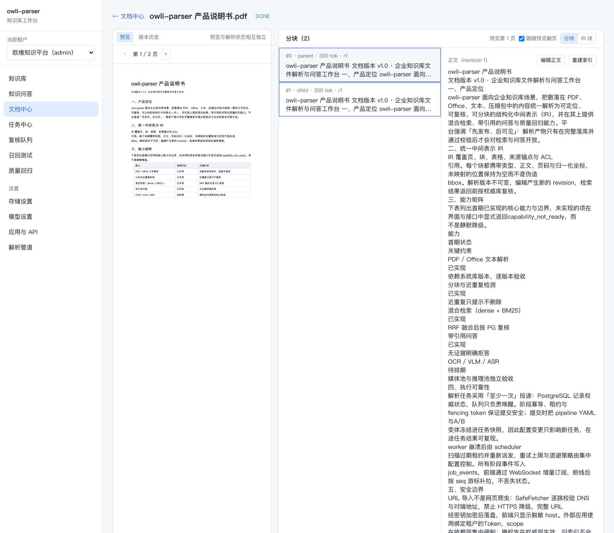

### 2.3 任务中心与任务详情：可恢复的解析过程，而不是一个转圈

任务中心是运维的第一屏：状态、当前阶段、页级进度、来源锚点覆盖率、错误摘要一眼扫完，
点进去才是单任务的时间线。

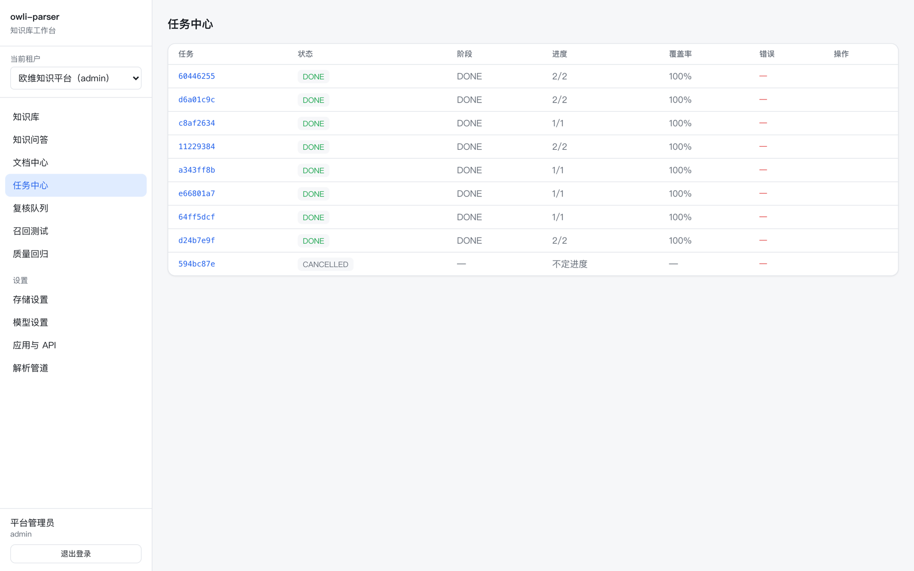

详情页有七个阶段（ROUTING → PARSING → ENRICHING → NORMALIZING → CHUNKING → INDEXING → PUBLISHING）、
逐条事件（含 `from_state → to_state`）、页级步骤表。前端通过 WebSocket 增量订阅，
断线自动降级为快照轮询，切换任务会清理旧连接。

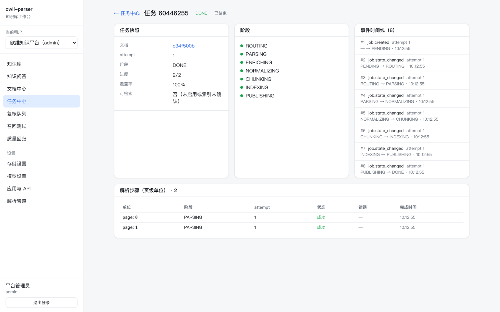

### 2.4 召回测试台与质量回归：把「感觉搜得还行」变成可对比的数字

召回测试台展示每个通道的排名、原始分与 RRF 贡献；支持同 query 两组参数顺序执行并并排 diff
（只展示差异项与排名变化，不把不同分数量纲的分数硬相加）。

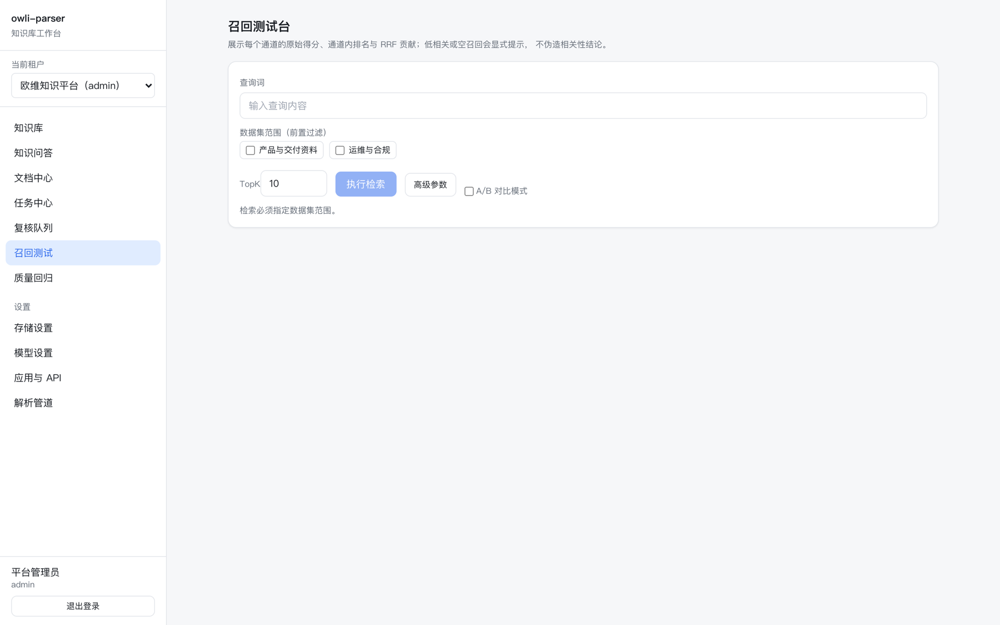

质量回归页把 CLI 与页面统一到同一份运行记录：`state`、指标 chips、趋势图、明细与 diff。
`failed` 运行用警示色标出，单侧缺失的指标显示 `—`。

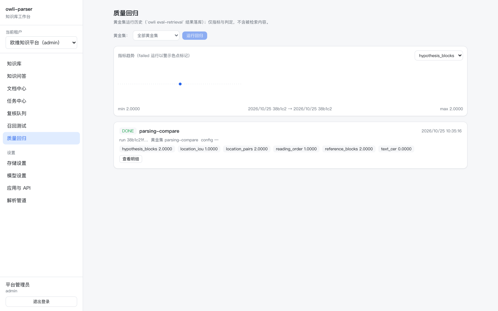

### 2.5 解析管道：YAML 是唯一事实源，画布只是它的视图

路由规则（格式 → 适配器 → 降级链）用 YAML 描述，可版本化保存、可 `If-Match` 防并发覆盖、
可 dry-run 预检。画布与表单是同一份 YAML 的两种编辑视图，保存前编译校验。

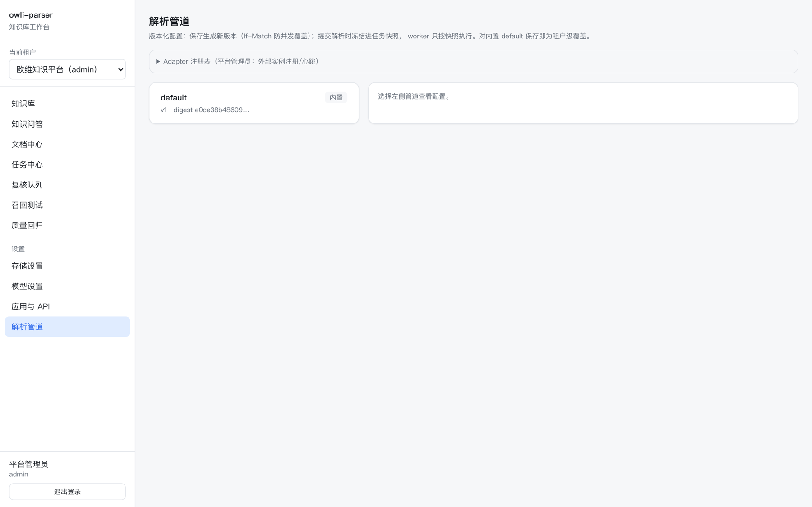

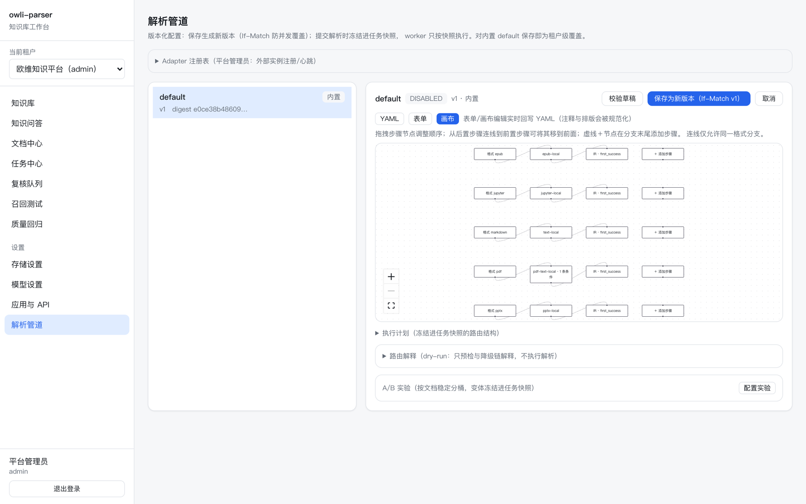

### 2.6 应用与 API：外部系统接入的权限边界写在明面上

scope 注册表、数据集 grant、Token 一次性明文展示、撤销传播与调用记录。
应用请求在依赖层集中强制 scope（fail-closed：未登记的接口一律拒绝）。

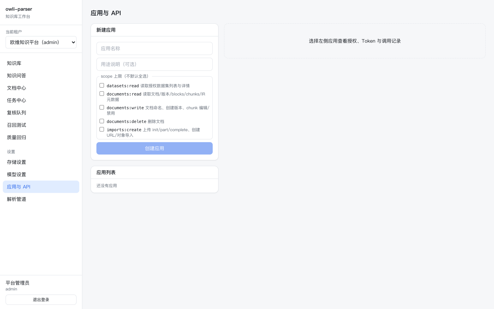

### 2.7 配置类页面：连接、存储与绑定

<table>
  <tr>
    <td width="50%">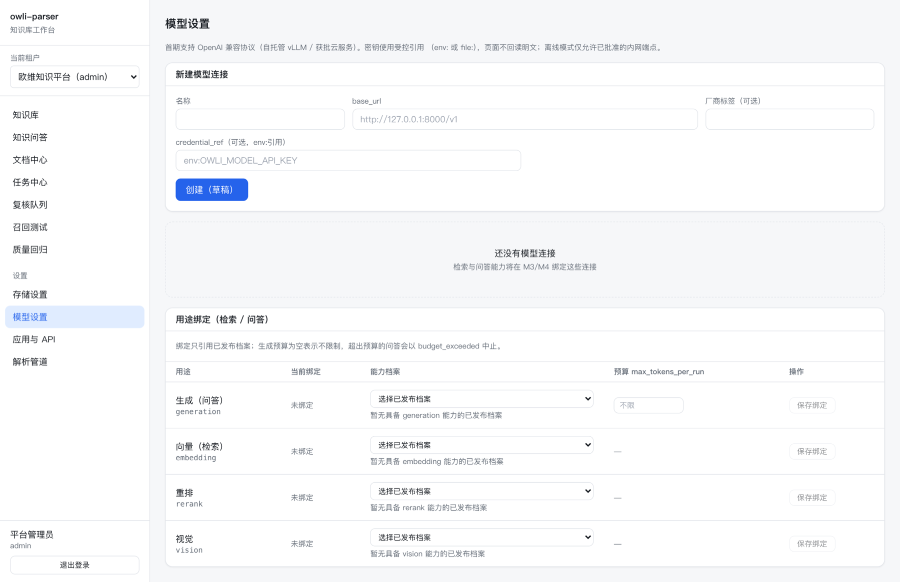</td>
    <td width="50%">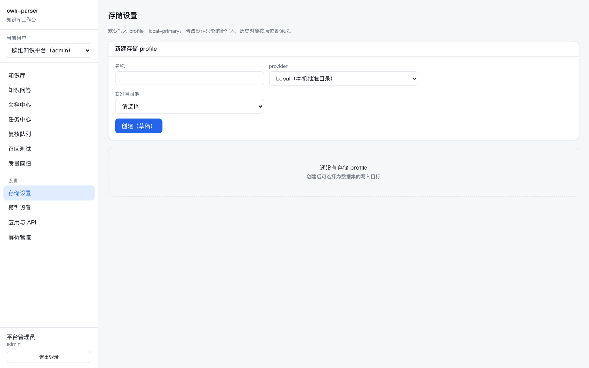</td>
  </tr>
  <tr>
    <td><b>模型设置</b>：连接（端点 + write-only 凭据）→ 能力档案（不可变）→ 用途绑定（generation / embedding / rerank / vision，含 token 预算）。</td>
    <td><b>存储设置</b>：Local / S3 / OSS 的 profile 生命周期（草稿 → 校验 → 隔离前缀 IO 测试 → 发布 → 读写停用）。</td>
  </tr>
</table>

### 2.8 知识问答与复核队列：不确定就明说

问答页的措辞即产品承诺：回答只依据检索到的证据、用 `[n]` 标注引用编号，没有依据时明确拒答，
不编造内容；停止或断开连接即取消本次运行。数据集范围可勾选，不选等于全部可访问数据集。

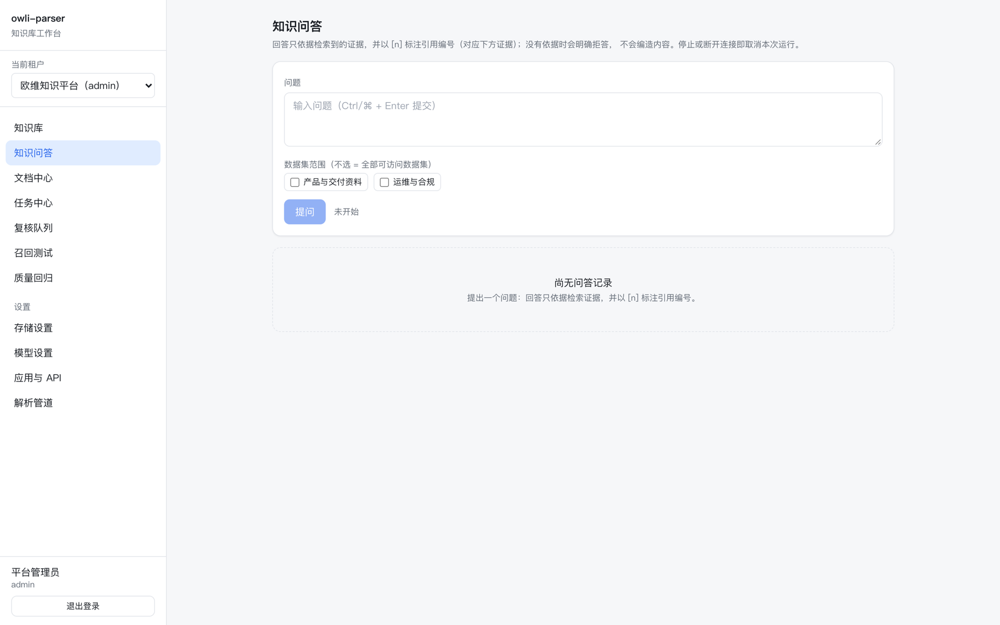

复核队列承接解析任务里的低置信块，处置是 CAS 语义（仅 `open` 可处置，重复处置返回 409，
不覆盖他人结论）。未配置生成模型时问答页保持初始态、无低置信块时复核队列为空——
**空状态本身也是设计的一部分**：它告诉用户下一步该做什么，而不是渲染一堆假的示例数据。

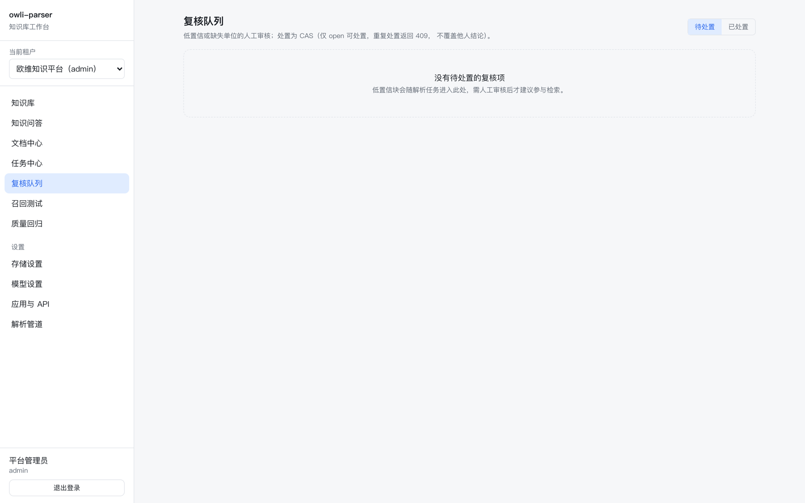

### 2.9 截图索引

| 文件 | 内容 |
|---|---|
| `01-login.png` | 登录页（会话建立前的唯一入口） |
| `02-datasets.png` | 知识库（数据集）列表与创建 |
| `03-documents.png` | 文档中心：上传、URL 导入、版本状态 |
| `04-tasks.png` | 任务中心列表 |
| `05-task-detail.png` | 任务详情：阶段 / 事件时间线 / 页级步骤 |
| `06-workbench.png` | 文档工作台：分块视图 |
| `06b-workbench-block.png` | 文档工作台：选中块的来源锚点与置信度 |
| `07-review.png` | 复核队列 |
| `08-retrieval.png` | 召回测试台：通道排名与 RRF 贡献 |
| `09-quality.png` | 质量回归：运行记录与指标趋势 |
| `10-chat.png` | 知识问答 |
| `11-settings-storage.png` | 存储设置：profile 生命周期 |
| `12-settings-models.png` | 模型设置：连接 / 档案 / 用途绑定 |
| `13-settings-applications.png` | 应用与 API：scope 与 Token |
| `14-settings-pipelines.png` | 解析管道列表（内置 default 与版本 digest） |
| `15-pipeline-canvas.png` | 解析管道画布 |

---

## 3. 小白术语表

读代码前先把这十个词对上号，后面会轻松很多。

| 术语 | 一句话解释 | 在本项目里的位置 |
|---|---|---|
| **IR（中间表示）** | 解析结果的统一中间格式：页、块、表格、来源锚点、ACL 引用 | `contracts/ir.schema.json`、`modules/parsing/normalize.py` |
| **块（block）** | IR 的最小内容单元（标题、段落、表格行组…），带类型与来源 | `ir.blocks[]` |
| **版本（version）** | 一次解析产出的不可变快照；编辑产生新 revision，不改历史 | `doc_versions` 表 |
| **发布（publish）** | 把某个版本「扶正」为对外可见/可检索的版本 | `module.catalog.publish_version` |
| **分块（chunk）** | 给检索用的切片（父块/子块/表格行组），有 token 预算 | `chunk_revisions` 表 |
| **租约 + fence** | worker 干活要「续租」，被抢占后旧 worker 的提交会被拒绝 | `jobs.lease_seconds`、`fencing_token` |
| **outbox** | 业务事务里先记一条「待派发事件」，再由调度器投递，避免丢任务 | `outbox_events` 表 |
| **RRF** | 把多路检索的**排名**融合（而不是原始分相加）的经典方法 | `modules/retrieval/domain.py` |
| **scope** | 外部应用能做什么的权限位（如 `documents:read`） | `contracts/scopes.py` |
| **黄金集（golden set）** | 人工标注的评测样本，用固定指标防止「改坏了却不知道」 | `golden_sets` / `golden_runs` 表 |

---

## 4. 能力地图与边界

### 4.1 已实现

| 领域 | 能力 |
|---|---|
| 接入 | 本地小文件直传（multipart）、分片上传、HTTP(S) URL 导入（SSRF 防护）、已配置存储对象导入 |
| 解析 | TXT / MD / CSV / JSON / YAML / 数字版 PDF / DOCX / PPTX / XLSX / EML / EPUB / Jupyter Notebook / ZIP（文本类条目） |
| 后处理 | 脚本级语言检测（zh/ja/ko/ru/ar/latin/mixed/unknown）、精确去重、近重复提示（字符 bigram Jaccard ≥ 0.7，只报告不删除）、乱码率（U+FFFD） |
| 中间表示 | IR 2.0：页几何（含旋转/裁剪）、块类型、表格结构、来源锚点、置信度三态（有值/未知/未评估） |
| 分块 | 父块 + 子块、表格行组视图、token 预算与重叠、`tokenizer_ref` 记录 |
| 任务 | 状态机（含 `PARTIAL_DONE`）、租约/心跳/fence、取消/重试、事件流（WS + HTTP 补拉） |
| 复核 | 低置信块与缺失单位自动登记、幂等重建、CAS 处置、工作台直达定位 |
| 存储 | Local / S3 / 阿里云 OSS，同一套 contract suite 锁定语义；profile 生命周期（草稿/校验/隔离前缀 IO 测试/发布/读写停用） |
| 模型 | 连接 → 能力档案 → 用途绑定三层；embedding / rerank / generation 客户端；凭据 write-only |
| 检索 | Qdrant dense + OpenSearch BM25 + 内存实现；RRF 融合；PG 权威复核；参数逐次覆盖与回显；A/B 参数对比 |
| 发布 | manifest 冻结（`chunk_id:revision + digest`）、逐通道确认、`retrieval_ready` 语义、编辑→重索引闭环 |
| 问答 | SSE 流式、证据冻结、引用校验、无证据拒答、token 预算、断流重放、取消 |
| 质量 | 解析指标（CER/WER、表格 P/R/F1、阅读顺序 LCS、bbox IoU）；检索指标（Recall@K/P@K/MRR/nDCG）；黄金集与回归运行 |
| 观测 | 结构化日志（query 仅存 sha256 指纹）、Prometheus 文本指标、平台积压/租约/outbox gauge、脱敏审计 |
| 工程 | 契约快照 + 生成类型 + 漂移检测；四层 CI 门禁；Alembic 统一版本链；import-linter 架构约束 |

### 4.2 明确未做（并已在代码中显式失败，而不是假装支持）

- **OCR / VLM / ASR 与媒体池**：扫描件、图片、音视频解析未实现；相关格式会得到「无可用适配器」的明确结果。
- **真实检索引擎集群验收**：Qdrant / OpenSearch 适配器语义已由 MockTransport 契约测试锁定（HTTP 引导、过滤、写入、旧代清理），但真实引擎版本/TLS/容量/重建耗时需独立演练。
- **真实云存储链路验收**：S3 / OSS 语义由 fake SDK 契约套件锁定，凭据、网络与 SDK 版本行为待独立验收。
- **Office → PDF 的段落级页定位映射**：soffice 转换端口与适配器已就绪（二进制探测、隔离 profile、超时、产物校验），页内定位映射未完成。
- **跨页/模糊块的自动近似定位**：当前是「锚点质量三档 + 版本漂移提示」，不做自动模糊匹配——宁可说「定位不到」，也不猜。
- **Pipeline Studio 的可视化 A/B 与更大规模实验平台**：A/B 后端能力（稳定分桶、变体快照、报表）已具备，前端实验编排仍为配置式。

---

## 5. 架构总览

### 5.1 进程与数据权威

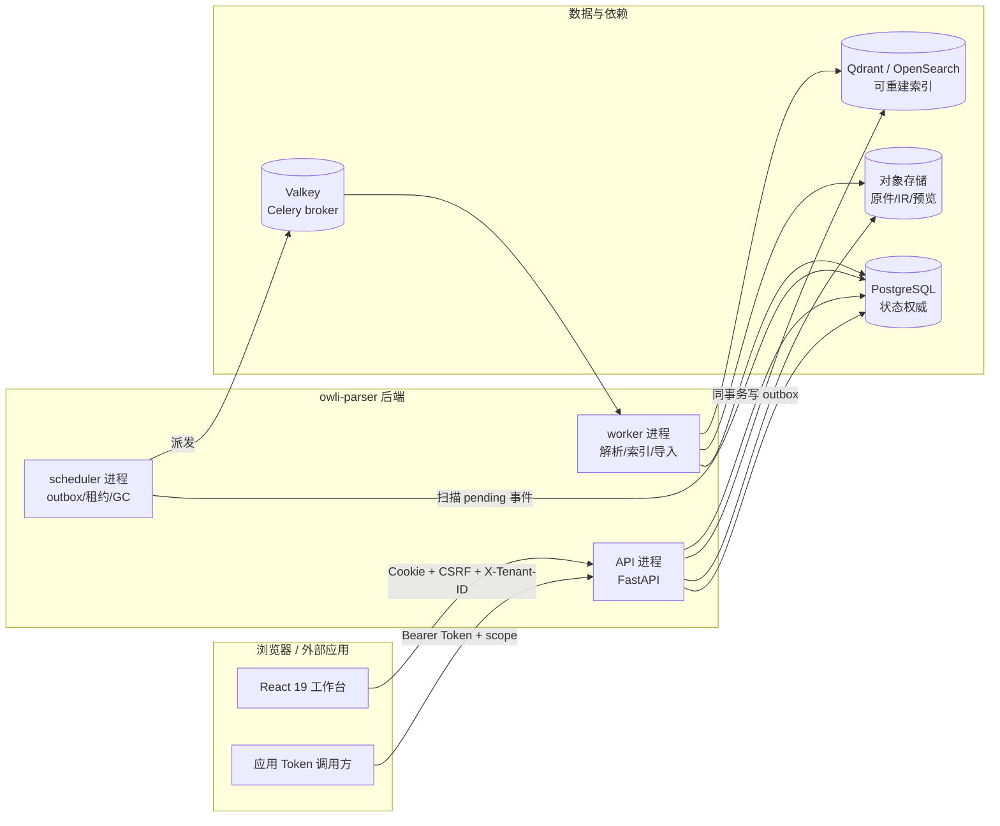

关键判断：**只有 PostgreSQL 与对象存储是数据权威**。Valkey、Qdrant、OpenSearch 全部可由数据库重建；
因此所有「队列丢了怎么办」「索引脏了怎么办」的问题，答案都是「从权威层重放」，而不是「相信下游」。

### 5.2 依赖方向

```text
bootstrap/     ← 唯一允许读取配置、组装容器的地方
  ↓
workflows/     ← 跨模块事务编排（提交解析、执行、导入下载）
  ↓
modules/       ← 业务领域：identity / access / catalog / artifacts / ingestion /
                 jobs / parsing / knowledge / retrieval / configuration / chat / retention
  ↓
ports/         ← 端口协议（Storage / Model / Queue / Secret / Fetcher / Outbox /
                 Audit / Idempotency / Context / Audit / Conversion / Retrieval）
  ↑
adapters/      ← 端口实现（本地/S3/OSS、Qdrant/OpenSearch/内存、soffice、模型网关）
  ↓
infrastructure/ ← DB / UoW / outbox / broker / 遥测（不含业务规则）
  ↓
core/          ← ID、时钟、上下文、错误、加密（无外部依赖）
```

`lint-imports` 在 CI 中强制执行上面的方向：`core` 不允许依赖 `modules`，`modules` 不允许依赖
`bootstrap`，`adapters` 只能实现 `ports`。这条约束让「模块化单体」在半年后仍是模块化单体。

### 5.3 一次解析任务的完整旅程

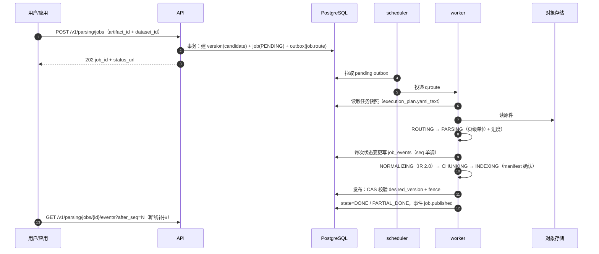

---

## 6. 十个关键设计细节

这一节是给「要读代码 / 要评审 / 要二次开发」的同学准备的。每条都写清楚**问题是什么、方案是什么、
边界在哪**。

### 6.1 契约先行：OpenAPI + IR Schema + 事件 Schema 三段防漂移

后端用 Pydantic 定义请求/响应与 IR，`owli contracts export` 导出确定性序列化的快照：

```text
contracts/
├── openapi.json        # 全部 HTTP 接口
├── ir.schema.json      # IR 2.0（页/块/表格/锚点/质量报告）
└── event.schema.json   # 任务事件与实时消息
```

防漂移由三段链完成：

1. **快照 check**：CI 执行 `owli contracts check`，代码与快照不一致直接非零退出；
2. **类型生成**：前端 `pnpm gen:api` 由快照生成 `src/api/generated.ts`，不手写接口类型；
3. **路径漂移测试**：vitest 扫描前端所有 `request()` 路径逐段比对快照（含模板参数与 query 归一化）。

写入体进一步用 `satisfies` / 契约守卫函数接入生成类型（`datasetCreateBody`、`chunkPatchBody`），
字段重命名会在 `tsc` 阶段就报错，而不是上线后 422。

> 为什么值得：前后端两个人同时改一个接口，最容易出现的不是编译错误，而是「字段名悄悄对不上」。
> 把契约变成 CI 门禁后，这类问题从「线上发现」提前到「提交时发现」。

### 6.2 至少一次投递：幂等 + 租约 + fence + outbox

任务系统最怕两件事：**任务丢了** 和 **任务被执行两次**。本项目的组合拳：

| 机制 | 解决什么 | 关键实现 |
|---|---|---|
| outbox | 业务事务与消息投递不一致 | 同一事务写 `outbox_events`，scheduler 扫描 pending 派发，失败保留并退避 |
| 租约 + 心跳 | worker 挂了任务没人管 | `lease_seconds` / `heartbeat_seconds`，scheduler 定期 sweep 过期租约 → `RETRY_WAIT` |
| fencing token | 旧 worker 醒来后覆盖新结果 | 每次认领递增 fence，所有状态提交带 fence 校验 |
| 阶段幂等 | 重试重复写数据 | 每个阶段以 `job_id + stage` 为单位可重入；产物按内容哈希去重 |
| 任务快照 | 配置在途变化导致结果不可复现 | 提交时把 pipeline YAML + digest 冻结进 `execution_plan`，worker 只按快照执行 |

> 边界：这是「至少一次 + 幂等」而非「恰好一次」。对外表现是「不会丢、不会重复发布」，
> 而不是「副作用绝对不会被执行两次」。

### 6.3 发布协议：先落库，再确认索引，最后才对检索可见

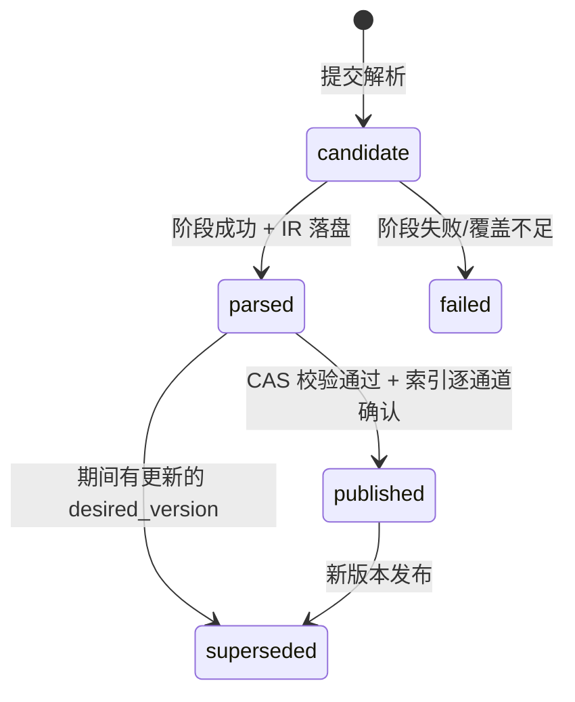

三条不变量：

1. **desired / visible 分离**：`desired_version_id` 表达「想要哪个」，`visible_version_id` 表达「现在能看哪个」；
2. **manifest 冻结**：发布时把 `chunk_id:revision + digest` 集合写入 `index_manifests`，索引写入逐通道确认；
   并发 revision 漂移时确认被拒（任务失败，安全方向优先）；
3. **读时权威复核**：检索命中后按 PG 的 `current_revision / enabled / deleted_at` 复核，
   索引残留**不会**把旧内容召回给用户。

`PARTIAL_DONE` 只在「覆盖率达到阈值且发布成功」时产生；缺失单位在 coverage 报告与复核队列里逐条列出，
绝不把「缺页」伪装成「成功」。

### 6.4 解析管道：YAML 是唯一事实源，提交时冻结

管道的本质是一棵「格式 → 适配器 → 降级链」的路由树：

```yaml
# 节选 backend/src/owli_parser/resources/default_pipeline.yaml
schema_version: "1.0"
name: default
revision: 1
pipelines:
  pdf:
    mode: first_success          # 优先降级：前一个不满足条件/失败才试下一个
    candidates:
      - adapter: pdf-text-local
        when: { text_layer_ratio: { gte: 0.5 } }
  docx:
    mode: first_success
    candidates:
      - adapter: docx-local
  # 未安装的增强分支（OCR/VLM/ASR）不得在默认配置中引用未注册 adapter
```

设计要点：

- **保存即新版本**：`PUT /v1/pipelines/{name}` 生成新版本，旧版自动失活；`If-Match` 缺失或过期 → `412`；
- **保存前编译校验**：非法 YAML、name 不一致、引用未知适配器 → `422`，不会把坏配置写进历史；
- **租户覆盖内置**：同名 `default` 保存为租户级覆盖，只影响本租户新提交的任务；
- **A/B 实验**：按 `bucket_key`（默认 artifact id）稳定分桶，变体 YAML 也随任务冻结，`traffic_percent` 控制比例；
- **三种编辑视图**：YAML / 表单 / 画布，互相同步，注释与排版会被规范化（写在 UI 上，不藏着）。

### 6.5 IR 与来源锚点：宁可「定位不到」，也不伪造坐标

IR 的每个块都可以带 `source_refs`，锚点类型覆盖：

| 锚点类型 | 含义 | 前端行为 |
|---|---|---|
| `page_region` + `bbox` | 页内归一化区域（0-1） | 翻页 + 百分比高亮（不依赖像素尺寸） |
| `page_region`（无 bbox） | 只能定位到页 | 按钮「仅到页」，不画假框 |
| `text_span` | 文本偏移 | 标记「无页面坐标，不可定位」 |
| `table_region` | 表格区域 | 定位到表格块并展示结构 |

三个诚实设计：

1. **未评估 ≠ 0**：置信度用 `-1` 哨兵表示「未评估」，UI 显示「未评估」，不显示 0.0000；
2. **版本漂移提示**：预览原件与列表版本不一致时，明确提示「锚点可能偏移」；
3. **旋转/裁剪不丢文本**：`rotation` 如实进入 IR，页归属按 `page_index` 断言（有 fixture 专门覆盖）。

### 6.6 后处理与分块：先清理，再切分，最后才索引

```text
文本 → 语言检测 → 精确去重 → 分块（父/子 + 表格行组） → 质量报告（quality-v3）
```

- **语言检测**是脚本级的（zh/ja/ko/ru/ar/latin/mixed/unknown），短文本与混合文本不强行归类，
  配置 hint 优先；拉丁语系细分留给后续 fastText 类方案；
- **精确去重**：空白折叠后相等且长度 ≥ 8 的块只留首个，比例写进质量报告；
- **近重复**只提示不删除（字符 bigram Jaccard ≥ 0.7），块数 > 800 时跳过并记 warning——
  宁可「这次没查」，也不给出不可信的结论；
- **分块预算**：`target_tokens / max_tokens / overlap_tokens / parent_max_tokens`，表格按行组视图切，
  保留完整表结构。

### 6.7 检索：双通道 + RRF + 权威复核 + 参数可复现

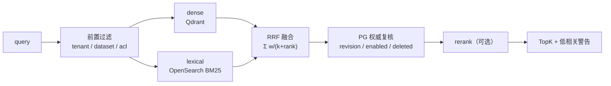

四个容易被忽略的细节：

1. **不把原始分相加**：不同通道分数量纲不同，RRF 只用排名；响应里逐条给出 rank、原始分与 RRF 贡献；
2. **`candidate_limit` 不可被调用方覆盖**：否则等于绕过前置过滤去捞全库；
3. **参数回显 `applied_params`**：每次请求返回实际生效的参数，A/B 实验才有可复现的口径；
4. **rerank 时序**：只在权威复核之后、只对权威正文评分；缺失候选不评分、保持原序置后并记 warning。

同步发布的写路径同样严谨：按 manifest 写入已启用通道 → 逐通道确认 → 才置 `retrieval_ready=true`。
编辑正文时同事务登记 `index_actions` + outbox，scheduler 派发、worker 按 PG 最新 revision 重建单块，
失败自动重派（上限 3 次后可手动 `reembed`）。

### 6.8 问答：证据冻结、引用校验、无证据拒答

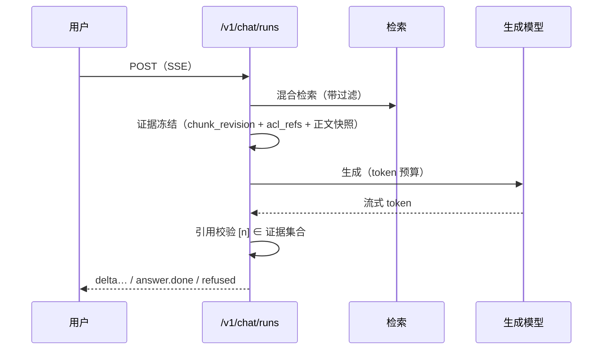

- **证据冻结**：`evidence_snapshots` 保存命中块的 revision、ACL 引用与正文；历史答案永远按快照重建，
  不会被「后来编辑过的 chunk」污染；
- **引用校验**：`[n]` 越界即判定伪引用并拒绝落 `answer.done`；
- **无证据拒答**：检索为空时明确拒答，而不是让模型自由发挥；
- **断流重放**：每个事件落 `chat_events`（seq 唯一），`GET /runs/{id}/events?after_seq=` 续传；
- **客户端断开**：run 直接置 `cancelled`，不留下「幽灵生成」。

### 6.9 安全边界：两条认证链、一个 scope 注册表、一个 SSRF 闸门

| 面 | 设计 |
|---|---|
| 浏览器用户 | HttpOnly Session Cookie + `X-OWLI-CSRF` + Origin 校验 + 登录限流 + 即时撤销 |
| 外部应用 | `Authorization: Bearer owli_pat_…`，租户绑定 + scope + 数据集 grant；与 Cookie 同时出现直接拒绝 |
| 租户隔离 | 所有数据访问带 `tenant_id`；`X-Tenant-ID` 必须与 membership/Token 绑定一致 |
| 应用授权 | `_APP_SCOPE_RULES` 注册表 + 依赖层集中强制，**未登记接口 fail-closed** |
| URL 导入 | SafeFetcher 逐跳 DNS 全量校验（含 IPv4-mapped IPv6）、对端地址核对、重定向次数限制、HTTPS 降级拒绝、offline 模式仅放行批准内网 |
| 密钥 | 配置里只写引用（`env:` / `file:`），数据库与快照不存明文；完整导入 URL 用 Fernet 加密，前端只显示脱敏 host |
| 访问审计 | 高频检索写结构化日志与指标，不污染 `audit_logs` 操作审计表（query 只存 sha256 指纹与长度） |

### 6.10 多存储 / 多模型：端口 + 适配器 + 同一套契约测试

三个存储后端（Local / S3 / OSS）跑**同一份** contract suite：roundtrip、范围读、校验和不符拒绝、
分片上传提交/中止/编号校验、缺失对象语义、presign 按 capabilities 分支。
用可注入的 fake SDK，测试不触网；真实云链路单独验收。

模型侧是三层结构：

```text
连接（endpoint + credential_ref + write-only 凭据）
  └── 能力档案（capabilities 不可变：模型/维度变更须新建）
        └── 用途绑定（generation / embedding / rerank / vision）
```

检索配置要求 dense 却没有 embedding 绑定时，任务显式 `capability_not_ready` 失败——
**不静默降级成纯 BM25**，因为那会悄悄改变召回质量并让评测失真。

---

## 7. 仓库目录结构

```text
backend/                    Python 工程（包 owli_parser，命令 owli，环境变量前缀 OWLI_）
├── src/owli_parser/
│   ├── bootstrap/          应用工厂、容器、配置、CLI、worker/scheduler、HTTP 路由
│   ├── workflows/          跨模块事务编排（提交解析/执行/发布/导入下载）
│   ├── core/               ID、时钟、上下文、错误、加密
│   ├── contracts/          IR 2.0、事件、scope 注册表（前后端单一事实源）
│   ├── modules/            identity / access / catalog / artifacts / ingestion / jobs /
│   │                       parsing / knowledge / retrieval / configuration / chat / retention
│   ├── ports/              Storage / Model / Queue / Secret / Fetcher / Outbox / Audit /
│   │                       Idempotency / Conversion / Retrieval
│   ├── adapters/           local·s3·oss 存储、Qdrant·OpenSearch·内存检索、soffice、模型网关
│   ├── infrastructure/     DB/UoW、outbox、审计、幂等、broker、遥测
│   └── resources/          defaults.yaml（全部默认配置）、默认解析管道 YAML
├── migrations/             Alembic 统一版本链（4 个 revision）
├── tests/                  237 个测试：单元 / 契约 / 安全 / 多租户 / 端到端
└── owli_dev.db             本地开发库（SQLite，非生产）

frontend/                   React 19 工作台
├── src/pages/              登录 / 知识库 / 文档 / 工作台 / 任务 / 复核 / 召回 / 质量 / 设置
├── src/components/         预览器、管道画布与表单、绑定面板、趋势图、共享组件
├── src/api/                client.ts（CSRF/租户/错误体）+ generated.ts（契约生成）
├── src/hooks/              useJobEvents（WS 优先、轮询降级）
└── src/test/               205 个 vitest 测试（含契约漂移与 MSW）

contracts/                  OpenAPI 与 IR/事件 JSON Schema 快照
deploy/                     Dockerfile 与 Compose profiles（base / retrieval）
config/                     无密钥环境覆盖示例
docs/                       运维手册、告警、截图
scripts/                    跨平台开发入口（scripts/dev.sh）与运维演练（ops_drill.sh）
```

代码规模：后端源码约 2.5 万行 Python，前端约 2 万行 TS/TSX，测试约 9.4 千行。

### 7.1 推荐阅读路线（带着问题读代码）

| 你想搞清楚的问题 | 从这里开始 | 然后看 |
|---|---|---|
| 一个文件怎么变成可检索的块 | [`workflows/submit_parsing.py`](backend/src/owli_parser/workflows/submit_parsing.py) | [`workflows/run_parsing_job.py`](backend/src/owli_parser/workflows/run_parsing_job.py) → [`modules/parsing/normalize.py`](backend/src/owli_parser/modules/parsing/normalize.py) |
| 权限是怎么卡住的 | [`bootstrap/dependencies.py`](backend/src/owli_parser/bootstrap/dependencies.py) | [`modules/catalog/domain.py`](backend/src/owli_parser/modules/catalog/domain.py) → [`contracts/scopes.py`](backend/src/owli_parser/contracts/scopes.py) |
| 检索为什么要「复核」 | [`modules/retrieval/service.py`](backend/src/owli_parser/modules/retrieval/service.py) | [`modules/retrieval/domain.py`](backend/src/owli_parser/modules/retrieval/domain.py) → [`modules/retrieval/indexing.py`](backend/src/owli_parser/modules/retrieval/indexing.py) |
| 问答的引用凭什么可信 | [`modules/chat/service.py`](backend/src/owli_parser/modules/chat/service.py) | [`bootstrap/routes_chat.py`](backend/src/owli_parser/bootstrap/routes_chat.py) → 前端 [`pages/ChatPage.tsx`](frontend/src/pages/ChatPage.tsx) |
| 配置为什么不写死 | [`resources/defaults.yaml`](backend/src/owli_parser/resources/defaults.yaml) | [`bootstrap/settings.py`](backend/src/owli_parser/bootstrap/settings.py) → [`bootstrap/container.py`](backend/src/owli_parser/bootstrap/container.py) |
| 前端为何这么写类型 | [`frontend/src/api/client.ts`](frontend/src/api/client.ts) | [`contracts/openapi.json`](contracts/openapi.json) → [`frontend/src/api/generated.ts`](frontend/src/api/generated.ts) |

---

## 8. 快速开始（本地 10 分钟）

### 8.1 前置

| 依赖 | 版本 | 说明 |
|---|---|---|
| Python | 3.12.x | 由 `uv` 自动下载与隔离（`.python-version`） |
| uv | ≥ 0.4 | Python 依赖与命令入口 |
| Node.js | ≥ 22 | pnpm ≥ 10 |
| 可选 | Docker | 生产形态：PostgreSQL + Valkey（本地开发用 SQLite 即可） |

### 8.2 后端

```bash
# 1) 安装依赖（cpu extra 提供 pypdf / python-docx / python-pptx / openpyxl）
uv sync --project backend --extra cpu

# 2) 生成开发密钥（生产必须用独立密钥管理，不要复用）
export OWLI_SESSION_PEPPER=$(openssl rand -hex 32)
export OWLI_TOKEN_PEPPER=$(openssl rand -hex 32)
export OWLI_SOURCE_URL_KEY=$(openssl rand -base64 32)

# 3) 校验配置 + 建库 + 初始化平台管理员
uv run --project backend owli config validate
uv run --project backend owli db upgrade
OWLI_BOOTSTRAP_ADMIN_PASSWORD='换成你自己的强密码' \
  uv run --project backend owli admin bootstrap --username admin

# 4) 三个进程（三个终端）
uv run --project backend owli serve --port 8000     # API
uv run --project backend owli worker --pool cpu     # 解析 worker
uv run --project backend owli scheduler             # outbox / 租约 / GC
```

> 没有 Redis 也能跑通「上传 + 解析」吗？**不能**。提交解析只写 outbox，需要 scheduler 通过
> broker 派发给 worker。生产/联调请用 `deploy/compose.yaml` 起 Valkey；本地做一次性验证时也可以
> 直接调用工作流（见 `tests/test_end_to_end.py` 的写法）。

### 8.3 前端

```bash
pnpm --dir frontend install
OWLI_API_PROXY=http://127.0.0.1:8000 pnpm --dir frontend dev   # http://127.0.0.1:5173
```

### 8.4 首次使用链路（建议按顺序走一遍）

1. 用管理员登录 → 「知识库」新建数据集；
2. 「文档中心」上传一个带文字层的 PDF（或用 URL 导入）；
3. 任务自动提交 → 在「任务中心」看阶段与事件 → 点进任务详情看页级步骤；
4. 「文档工作台」看预览、分块、IR 块、来源锚点与置信度；
5. 「召回测试」选数据集、输入关键词（需先启用检索，见第 9 节）；
6. 「质量回归」查看运行记录（`owli eval-retrieval` / `owli compare-ir` 产物）。

### 8.5 本地开发的三个必知配置

| 现象 | 原因 | 处理 |
|---|---|---|
| 浏览器不保存登录态 | 默认 `auth.session.cookie_secure=true`，只允许 HTTPS | 本地设 `OWLI_AUTH__SESSION__COOKIE_SECURE=false` |
| 登录后做任何写操作都 403 | 变更请求校验 `Origin`，必须与 `app.public_base_url` 一致 | 设 `OWLI_APP__PUBLIC_BASE_URL=http://127.0.0.1:5173`（与前端地址一致） |
| 解析成功但检索不到 | `retrieval.*_backend=memory` 是**进程内**索引，worker 写的索引 API 进程看不到 | 开发期用真实引擎（Qdrant/OpenSearch），或把解析与检索放在同一进程内验证 |

---

## 9. 配置与密钥

### 9.1 优先级

```text
init 参数  >  OWLI_ 环境变量  >  OWLI_CONFIG_FILE 指定的 YAML  >  backend/src/owli_parser/resources/defaults.yaml
```

- 所有可调参数集中在 `defaults.yaml`，业务代码只消费**类型化快照**，不散落硬编码；
- 环境变量用双下划线表达层级：`OWLI_JOBS__LEASE_SECONDS=60`；
- 覆盖示例见 [`config/env.example.yaml`](config/env.example.yaml)。

### 9.2 密钥只写引用

```yaml
auth:
  session_pepper_ref: "env:OWLI_SESSION_PEPPER"
tokens:
  pepper_ref: "env:OWLI_TOKEN_PEPPER"
imports:
  url_secret_key_ref: "env:OWLI_SOURCE_URL_KEY"
retrieval:
  qdrant:
    api_key_ref: "env:OWLI_QDRANT_API_KEY"     # 也可 file:/run/secrets/...
```

`owli config validate` 会明确告警「生产环境仍使用 memory 检索后端」这类危险配置，
并把问题在启动前暴露，而不是运行到一半才发现。

### 9.3 检索后端

| 配置 | 可选值 | 说明 |
|---|---|---|
| `retrieval.enabled` | `true/false` | 未启用时检索/问答接口返回 `capability_not_ready`，不返回空结果 |
| `retrieval.dense_backend` | `memory` / `qdrant` | memory 仅开发测试，不跨进程共享 |
| `retrieval.lexical_backend` | `memory` / `opensearch` | 同上 |
| `retrieval.channels` | dense / lexical | 按基线指标调整，可只开一路 |
| `retrieval.top_k` / `rrf_k` / `channel_weights` | — | 可被单次请求覆盖（`candidate_limit` 不可覆盖） |

本地联调真实引擎：

```bash
cp config/env.example.yaml config/retrieval.yaml   # 修改端点与 secret 引用
docker compose -f deploy/compose.yaml -f deploy/compose.retrieval-dev.yaml \
  --profile retrieval up -d
```

> `compose.retrieval-dev.yaml` 关闭 OpenSearch security plugin，仅供内部联调。
> 生产必须使用受 TLS、认证、备份与监控保护的外部集群。

---

## 10. API 与契约工作流

### 10.1 接口分组

| 前缀 | 用途 | 典型接口 |
|---|---|---|
| `/v1/auth` | 会话、CSRF、租户列表、WS ticket | `POST /auth/login`、`GET /auth/me` |
| `/v1/platform` | 平台管理（平台管理员） | `POST /platform/tenants`、`POST /platform/users` |
| `/v1/datasets` `/v1/documents` | 数据集合与文档版本 | `GET /documents`、`GET /documents/{id}/versions` |
| `/v1/uploads` `/v1/imports` | 上传与 URL/对象导入 | `POST /uploads/direct`、`POST /imports` |
| `/v1/parsing/jobs` | 任务提交与观测 | `POST /parsing/jobs`、`GET .../events?after_seq=` |
| `/v1/documents/{id}/blocks` `/chunks` | 工作台读取与编辑 | `GET .../blocks`、`PATCH /chunks/{id}` |
| `/v1/review/queue` | 复核队列 | `GET`、`POST .../resolve` |
| `/v1/retrieval/test` | 召回测试与 A/B | `POST`（含 `channel_weights` 等覆盖） |
| `/v1/quality/regression-runs` | 质量回归 | `GET`、`POST` |
| `/v1/chat/runs` | 问答（SSE） | `POST`、`GET .../events`、`POST .../cancel` |
| `/v1/storage-profiles` `/v1/model-connections` `/v1/model-profiles` | 存储与模型配置 | 创建/测试/发布/停用 |
| `/v1/pipelines` | 解析管道与实验 | `GET/PUT /pipelines/{name}`、`dry-run`、`experiment` |
| `/v1/applications` `/v1/secret-refs` `/v1/config-revisions` | 应用、Token 与配置审计 | 授予/撤销/轮换/调用记录 |
| `/metrics` `/healthz` `/readyz` | 观测与探针 | Prometheus 文本格式 |

### 10.2 最小调用示例

```bash
BASE=http://127.0.0.1:8000

# 登录（保存 Cookie）；响应里带 CSRF token
CSRF=$(curl -s -c cookie.txt -H 'Content-Type: application/json' \
  -d '{"username":"admin","password":"…"}' $BASE/v1/auth/login | jq -r .csrf_token)

# 查看可访问租户
TENANT=$(curl -s -b cookie.txt $BASE/v1/auth/tenants | jq -r '.[0].tenant_id')

# 建数据集
DATASET=$(curl -s -b cookie.txt -H "X-Tenant-ID: $TENANT" -H "X-OWLI-CSRF: $CSRF" \
  -H 'Content-Type: application/json' -d '{"name":"合同库","visibility":"tenant"}' \
  $BASE/v1/datasets | jq -r .id)

# 直传小文件 → artifact
ARTIFACT=$(curl -s -b cookie.txt -H "X-Tenant-ID: $TENANT" -H "X-OWLI-CSRF: $CSRF" \
  -F "dataset_id=$DATASET" -F "file=@合同.pdf" $BASE/v1/uploads/direct | jq -r .artifact_id)

# 提交解析
curl -s -b cookie.txt -H "X-Tenant-ID: $TENANT" -H "X-OWLI-CSRF: $CSRF" \
  -H 'Content-Type: application/json' \
  -d "{\"artifact_id\":\"$ARTIFACT\",\"dataset_id\":\"$DATASET\",\"filename\":\"合同.pdf\"}" \
  $BASE/v1/parsing/jobs
```

### 10.3 统一错误体与幂等

```json
{
  "code": "revision_conflict",
  "message": "版本已变化，请刷新后重试",
  "detail": {},
  "trace_id": "8f0c…"
}
```

- **`If-Match`**：所有「读改写」接口（数据集/文档修改、分块编辑、管道保存）必须带当前 revision，缺失或不一致返回 `412`；
- **`Idempotency-Key`**：URL/对象导入（`POST /v1/imports`）支持重放，同键不会重复生成导入任务；
- **错误码是稳定契约**：前端按 `code` 分支（如 `capability_not_ready`、`rate_limited`），不解析 message。

### 10.4 契约工作流

```bash
cd backend
uv run owli contracts export     # 导出快照到仓库根 contracts/
uv run owli contracts check      # 与代码比对；漂移以非零退出码失败（CI 门禁）

cd ../frontend
pnpm gen:api                     # openapi-typescript 生成 src/api/generated.ts
pnpm test                        # 含契约漂移测试：request 路径逐段对比快照
```

变更 API 的正确顺序：**改后端 → export → 提交快照 → gen:api → 提交生成类型**。
漏任何一步，`contracts check` 或 vitest 都会拦住。

### 10.5 评测与回归 CLI

```bash
# 解析质量对比（两个版本 IR → CER / 阅读顺序 / 表格结构 / 定位 IoU，落 golden_runs）
uv run owli compare-ir --tenant <tid> --reference <v1> --hypothesis <v2> \
  --max-cer 0.05 --min-reading-order 0.95

# 批量解析回归（cases 列表 + 阈值，逐条与聚合一起落库）
uv run owli parsing-regression --file cases.json --tenant <tid>

# 检索黄金集评估（Recall@K / P@K / MRR / nDCG@K，退出码即护栏）
uv run owli eval-retrieval --file golden.json
```

真实输出示例（本仓库演示数据）：

```text
run_id=38b1c21ff6334fa1bc4903790dfd414f passed=True
  text_cer: 0.000000
  reading_order: 1.000000
  table_structure_f1: —（无表格对）
  location_iou: 1.000000
  blocks: reference=2 hypothesis=2
```

注意 `—（无表格对）`：没有可比较的对象时**不给分**，也不按 0 计入宏平均。

---

## 11. 测试与质量门禁

### 11.1 本地命令

```bash
# 后端
uv run --project backend ruff check backend
uv run --project backend ruff format --check backend
uv run --project backend lint-imports --config backend/pyproject.toml
uv run --project backend mypy --config-file backend/pyproject.toml backend/src
uv run --project backend pytest -c backend/pyproject.toml backend/tests

# 前端
pnpm --dir frontend check        # typecheck + lint + vitest + build
```

### 11.2 测试矩阵（237 后端 + 205 前端）

| 层次 | 代表测试 | 锁定的语义 |
|---|---|---|
| 契约 | `test_contracts_export.py`、`test_contracts_security.py`、`contract-drift.test.ts` | 快照确定性、scope 不外泄、前端路径不漂移 |
| 存储 | `test_storage_contract.py`（24 例） | Local/S3/OSS 同一套语义（含 fake SDK 不触网） |
| 检索 | `test_retrieval.py`、`test_retrieval_adapters.py`、`test_retrieval_audit.py` | RRF 严格语义、过滤与权威复核、审计不含 query 原文 |
| 解析 | `test_pdf_geometry.py`、`test_postprocess.py`、`test_unicode_offsets.py` | 旋转/裁剪不丢文本、去重口径、偏移量正确 |
| 可靠性 | `test_recovery.py`、`test_job_steps.py`、`test_migrations.py` | 租约回收、fence 拒绝、空库迁移到 head |
| 安全 | `test_config_governance.py`、`test_contracts_security.py`、多租户矩阵 | 密钥脱敏、配置不可变、跨租户 404 |
| 端到端 | `test_end_to_end.py`、`test_chat.py` | 上传→解析→发布→检索→问答 |

### 11.3 CI（`.github/workflows/ci.yml`）

```text
backend job:      ruff check → ruff format --check → lint-imports → mypy strict
                  → pytest → owli contracts check
postgres job:     PostgreSQL 16 上从空库 upgrade head → 再次 upgrade（幂等）→ 校验 head
frontend job:     typecheck → eslint → vitest → build
```

任一项失败都会阻断合并。迁移只做 expand（新增列/表/索引），破坏性变更拆到后续版本。

---

## 12. 部署与运维

### 12.1 Compose 拓扑

```text
postgres  16          # 状态权威
valkey                # Celery broker（可重建）
migrate               # 一次性迁移容器（失败即停止发布）
api / worker / scheduler
artifacts 卷          # 原件 / IR / 预览
```

```bash
# 在仓库根创建 .env（compose 读取），注入 4 个必填变量：
# POSTGRES_PASSWORD / OWLI_SESSION_PEPPER / OWLI_TOKEN_PEPPER / OWLI_SOURCE_URL_KEY
docker compose -f deploy/compose.yaml --profile base up -d
```

### 12.2 升级 / 回滚 / 备份

```bash
scripts/ops_drill.sh check          # 只读：compose/服务/健康/迁移版本/备份目录
scripts/ops_drill.sh backup         # ./backups/<UTC>/（db.dump + artifacts.tgz + manifest.txt）
scripts/ops_drill.sh rollback-check # 只读：镜像/服务/迁移版本/健康
scripts/ops_drill.sh restore-drill ./backups/<UTC>   # 只在 owli_drill_* 临时库恢复
```

升级顺序：**构建镜像 → 迁移容器 → 先 api 再 worker/scheduler → 冒烟**。
回滚边界：迁移向后兼容时只切镜像；破坏性迁移禁止 `downgrade`，走备份恢复到新实例。

### 12.3 观测

| 类别 | 内容 |
|---|---|
| 指标 | `owli_retrieval_queries_total{low_relevance}`、`owli_retrieval_channel_queries_total`、`owli_retrieval_dropped_total`、任务积压/最老年龄、活跃租约、outbox 滞后、Token 拒绝计数 |
| 日志 | JSON 结构化（trace_id、路径、状态、耗时）；检索 query 只存 sha256 指纹与长度 |
| 告警 | [`deploy/prometheus/owli-alerts.yaml`](deploy/prometheus/owli-alerts.yaml) + [`docs/alerts.md`](docs/alerts.md) |
| 健康 | `/healthz`（存活）、`/readyz`（依赖就绪，检索不可用时明确返回） |

---

## 13. 已知边界与路线图

**近期会做**

1. OCR / 版面分析接入（图片、扫描件），并把「图片块」纳入 IR 的 page_region 锚点；
2. Office → PDF 的段落级页定位映射（转换端口已就绪，缺映射与验收）；
3. Qdrant / OpenSearch 真实集群压测与重建演练（容量、耗时、故障恢复）；
4. 前端 Pipeline Studio 的可视化 A/B 编排与实验报告导出。

**暂不打算做（避免伪精确）**

- 跨页模糊匹配「自动猜定位」：宁可标注「仅到页/不可定位」；
- 把原始检索分数量纲化后相加：RRF 之外的新融合策略必须先有离线增益证据；
- 多租户共享索引：租户隔离优先于索引复用。

### 13.1 常见问题（FAQ）

**为什么不直接套一个现成的 RAG 框架？**
解析、索引与可见性在这里是**受控的业务流程**：需要发布协议、多租户隔离、来源可追溯、可评测回归。
通用框架通常把「解析 → 分块 → 索引」当作黑盒，很难回答「这个块是哪一版、能不能被这个租户看到」。

**为什么本地开发用 SQLite，生产用 PostgreSQL？**
SQLite 只用于开箱跑通；并发写、强约束、索引与运维能力都不适合生产。
代码只依赖 SQLAlchemy 与迁移链，两者切换是配置问题，不是重写。

**为什么检索默认只开 lexical？**
dense 需要 embedding 绑定与真实向量库。没有绑定时宁可只跑 BM25 并在响应里如实返回 `channels_used`，
也不偷偷用哈希向量充数——那会让评测数字失去意义。

**为什么 DOCX / XLSX 显示 `application/zip`？**
OOXML 本质就是 ZIP 容器，magic 检测如实反映容器类型；适配器路由同时参考扩展名与内容探测。

**删除文档后索引里还有残留怎么办？**
软删先让权威层「看不见」（检索命中后复核直接剔除），索引与对象由 retention 按保留期回收；
即使 GC 尚未执行，也不会召回已删除内容。

### 13.2 与设计基线的关系

完整设计基线见 [`kb_parser_delivery_document.md`](kb_parser_delivery_document.md)（总体方案 + 后端 + 前端 + 优化补充 + 生成规范）。
**该文档是设计基线，不代表所有能力已实现或已通过性能/合规验收**；本文第 4 节才是实现状态口径。

---

## 14. 本次交付附带的问题修复

为产出上述**真实截图**，在真实运行中定位并修复了 4 个会在生产使用中暴露的问题：

| # | 问题 | 根因 | 修复 | 影响面 |
|---|---|---|---|---|
| 1 | 文档预览（PDF/图片/文本/下载）全部 403 | 预览资源由浏览器直接加载，无法携带后端强制的 `X-Tenant-ID` | 预览统一经 fetch 补租户头（图片转 blob、文本直接读、PDF 用 pdf.js `httpHeaders`、下载改为取流后本地生成链） | `components/PreviewPanel.tsx`、`pages/WorkbenchPage.tsx` |
| 2 | 刷新页面 / 直达链接会掉回登录页 | 路由守卫在 `/auth/me` 返回前就把「未登录」判定了 | 会话增加 `initialized` 恢复态，恢复中显示占位而不重定向；已登录访问 `/login` 自动回工作台 | `stores/session.ts`、`App.tsx`、`pages/LoginPage.tsx` |
| 3 | 任务详情时间线恒为 0，已完成任务阶段全灰 | WS 快照只下发 `latest_seq` 不下发历史事件；终态任务的 `stage=DONE` 不在阶段数组里 | 快照携带历史事件并由前端合并去重；成功终态视为全部阶段已到达 | `bootstrap/routes_realtime.py`、`hooks/useJobEvents.ts`、`pages/TaskDetailPage.tsx` |
| 4 | 未启用的管道徽标显示 `CANCELLED` | 复用了任务状态徽标语义 | 新增 `DISABLED` 状态样式与语义 | `pages/PipelinesPage.tsx`、`components/shared.tsx` |

回归状态：后端 237 项测试通过（1 项按环境跳过），前端 205 项测试通过，`ruff` / `mypy strict` /
`lint-imports` / `tsc` / `vite build` 均通过。

---

## 15. 文档导航与合规提示

| 文档 | 内容 |
|---|---|
| [`kb_parser_delivery_document.md`](kb_parser_delivery_document.md) | 设计基线：总体方案、后端、前端、优化补充、生成规范 |
| [`docs/operations.md`](docs/operations.md) | 升级/回滚/备份恢复演练/故障处置/容量调优 |
| [`docs/alerts.md`](docs/alerts.md) | 告警规则说明与处置手册 |
| [`docs/screenshots/`](docs/screenshots/) | 全部界面截图 |
| [`config/env.example.yaml`](config/env.example.yaml) | 无密钥环境覆盖示例 |
| [`contracts/`](contracts/) | OpenAPI 与 IR/事件 Schema 快照 |
| [`backend/README.md`](backend/README.md) | 后端常用命令速查 |

**合规提示**：仓库默认依赖以商用合规准入为前提，许可证与依赖版本在发布流程中逐版本核对（见设计文档 §17）。
本文档与代码不构成法律意见；OCR/模型权重/云服务的实际授权范围需按你的部署形态单独确认。
